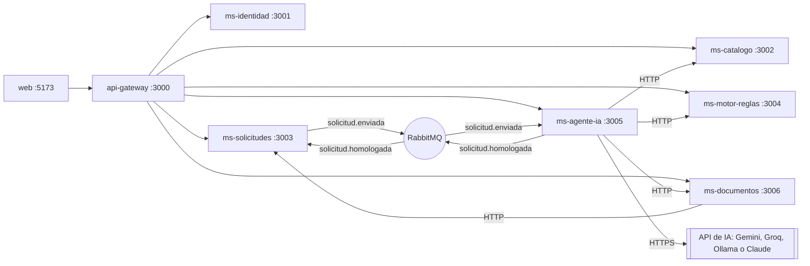

# Arquitectura de HomologaFISEI (Sprint 3)

## Servicios

El gateway revisa el token en cada llamada y deja pasar solo al administrador en las rutas de `SOLO_ADMIN` (importar planes, crear carreras y cambiar reglas).

## Mensajes

| Evento | De -> a | Contenido |
|---|---|---|
| `solicitud.enviada` | ms-solicitudes -> ms-agente-ia | `{ solicitudId, tipo, carreraDestino, materias[] }` |
| `solicitud.homologada` | ms-agente-ia -> ms-solicitudes | `{ solicitudId, resultados[] }`, uno por materia con su informe |
| `homologacion.completada` | ms-agente-ia -> auditoría | `{ id, resultado, aprobada, nueva }` |
| `plan.importado` | ms-catalogo -> auditoría | el plan guardado |
| `informe.generado` | ms-documentos -> auditoría | `{ solicitudId }` |

`tipo` es `INTERNO` (por defecto, igual que el Sprint 2) o `EXTERNO`. En `EXTERNO`, cada materia trae `codigo` (`EXT-CALCULO-II`), `nombre`, `creditos`, `horas`, `nota` (convertida sobre 10), `notaOriginal`, `escala`, `anio` y `silaboId`.

## Flujo de una materia de otra universidad (EXTERNO)

1. `ms-agente-ia` recibe `solicitud.enviada` con `tipo: EXTERNO`.
2. Por cada materia pide el texto del sílabo a `ms-documentos` (T43).
3. **Materia más parecida (T43).** Primero busca una materia de la FISEI con el mismo nombre. Si no hay, le pasa a la IA el sílabo y las materias candidatas (código, nombre y temas) y la IA devuelve `{ codigo, parecido }`. Con parecido menor a 50 el resultado es *Sin materia equivalente*.
4. **Contenidos (T44, RN-01).** La IA compara el sílabo (recortado a 12 000 caracteres) con el plan analítico de la materia elegida.
5. **Reglas (T46, RN-02 a RN-05).** `ms-motor-reglas` evalúa con los créditos, horas, nota y año que escribió el estudiante, frente a los del catálogo.
6. **Informe (T48).** Trae las 5 causas, además de `parecido`, `notaOriginal` y `escala`. La causa de RN-04 dice por ejemplo «16/20 equivale a 8,0/10 (mínimo 7)».
7. Si algo falla (IA saturada, falta el sílabo, faltan créditos u horas), esa materia queda *Pendiente* y las demás siguen. El estudiante puede reintentar.

## Proveedor de IA

| `IA_PROVEEDOR` | API | Modelo por defecto |
|---|---|---|
| `gemini`, `groq`, `ollama` | compatible con OpenAI (`/chat/completions`) | `gemini-flash-latest`, `llama-3.3-70b-versatile`, `qwen2.5:7b` |
| `claude` | Anthropic (`/v1/messages`, `x-api-key`, `anthropic-version: 2023-06-01`) | `claude-sonnet-5-5`, respaldo `claude-haiku-5-5` |

Los diagramas de clases y de casos de uso están en `docs/clases.png` y `docs/casos-de-uso.png`.
